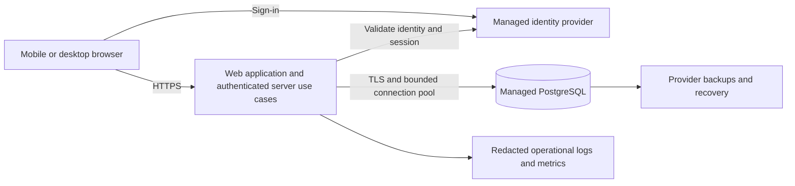

# Cloud architecture options — v0.8

Date: 2026-10-26. Status: historical comparison, superseded for selection by the unanimous vote in ADR-003 and 09-architecture-vote.md. Option A is selected; pricing/operational details remain subject to qualification. Scope: specifications only; no resources created, services purchased, or deployment performed. This comparison supports ADR-003 and the existing journal-first architecture.

## Step 1 — Establish decision inputs

Confirmed: responsive web, one account across devices, journal/collections core, English project/interface text, and cloud hosting with a cloud database. Proposed: online-first operation and a modular application with managed PostgreSQL.

Audience now confirmed: initial portfolio/demo to attract clients; prioritize fast MVP delivery. Monthly budget, visitor-access model, usage, existing cloud accounts/experience and required region remain open. Do not infer usage scale or a production cost ceiling from the examples. Offline synchronization remains outside the initial proposal.

For comparison only, assume one maintainer, low initial traffic, text/numeric records without attachments, and one initial application region. These are sizing assumptions, not accepted product limits.

## Step 2 — Separate responsibilities

The cloud database is not accessed using browser-held database credentials. The server derives the owner from verified identity and authorizes every operation. Hosting, identity, and database may be separate managed services. A managed database alone does not supply application authorization, an identity flow, or a tested recovery procedure.

Logical modules remain Journal, Reflection, DataPortability, optional Goals, and optional Tracking. This proposal does not introduce microservices, a queue, Redis, real-time channels, or a separate search cluster. The browser need not know the hosting/database vendor.

## Step 3 — Compare deployment options

| Option | Application | Database and identity | Strengths (engineering assessment) | Work and limitations |
| --- | --- | --- | --- | --- |
| A — Integrated managed services | TypeScript/Next.js on Vercel, server use cases in the same project | Supabase managed PostgreSQL and Supabase Auth | Less identity/database integration work; a direct path to the journal MVP | Two providers; serverless connection limits and provider-specific auth adapters; regional placement and backup plan must be checked |
| B — Container application | One containerized web/server application on Render; Next.js/TypeScript is a candidate, not mandatory | Render managed PostgreSQL; separate managed OIDC identity provider, still to select | Conventional server lifecycle; container portability; application and database can share a hosting provider | Identity remains a separate integration/cost; configure pool size, deployment migrations and recovery; backup entitlements depend on workspace tier |
| C — AWS infrastructure | Containerized web/server application on ECS/Fargate, potentially ECS Express Mode | RDS for PostgreSQL and Cognito | Detailed infrastructure/network controls; suitable if AWS expertise or requirements justify them | More configuration and operational work: networking, IAM, ingress, secrets, deployment and service monitoring |

All three can implement the same logical domain. Choosing PostgreSQL does not force one provider. Auth identities must map to stable internal account IDs; this reduces, but does not eliminate, migration work. Provider-specific adapters and deployment configuration remain unavoidable.

AWS App Runner is excluded as the default for a new account because AWS stopped accepting new App Runner customers on April 30, 2026. [AWS notice](https://aws.amazon.com/apprunner/).

### Cost and recovery comparison

Prices checked on 2026-10-26, USD; list prices are starting points, not quotes or guaranteed monthly totals.

- A: Supabase Pro starts at $25/month and includes seven days of daily database backups; Free can pause after inactivity and is not equivalent to this recovery configuration. [Supabase pricing](https://supabase.com/pricing), [backup documentation](https://supabase.com/docs/guides/platform/backups).
- A: Vercel Pro starts at $20/month for one developer seat; Hobby is restricted to personal noncommercial use. A one-seat Vercel Pro plus base Supabase Pro illustration starts at $45/month before overages, taxes, email, domain, extra environments, or add-ons. Personal qualifying use could pair Hobby with Supabase Pro from $25/month with the same exclusions. [Vercel pricing](https://vercel.com/pricing).
- B: estimate workspace plan + application compute + database compute/storage + identity/email + backup/export storage. Do not equate a workspace subscription with the full deployment cost. Paid Postgres PITR covers three days on Hobby and seven days on Pro or higher. Seven-day logical export retention is documented, but automatic daily export scheduling must be designed/verified separately if used to satisfy RNF-07. [Render pricing](https://render.com/pricing), [recovery documentation](https://render.com/docs/postgresql-backups).
- C: estimate Fargate CPU/memory, RDS instance/storage/backups, ingress/load balancing, network egress/NAT if applicable, Cognito, secrets and logs. A region/sizing-specific calculator estimate is required; no fixed total is asserted. [Fargate pricing](https://aws.amazon.com/fargate/pricing/), [RDS PostgreSQL pricing](https://aws.amazon.com/rds/postgresql/pricing/).

Domain, transactional email, preview/staging databases, and monitoring can add cost in every option. Database backup availability does not prove the application can meet its 24-hour recovery target; restore must be exercised. Free-tier experiments are not represented as meeting production RNF-07 automatically.

## Step 4 — Proposed common implementation rules

- PostgreSQL stores journal entries, collection links, movements, reviews and account ownership; optional tracking adds versioned record schemas/values/indicators. Avoid a table per goal.
- All related mutations execute in one database transaction: for example task destination, Movement, audit change and command result. Multiple independent HTTP writes do not provide that atomicity.
- Persist commandId scoped by owner, request fingerprint and completed result; concurrent duplicate submissions resolve to the stored outcome. Version checks prevent silent lost updates.
- Every query and cross-entity reference enforces ownership. If PostgreSQL RLS is adopted, establish trusted owner context inside the transaction; do not assume direct SQL connections automatically carry an auth-provider user identity. Runtime roles must not silently bypass the intended policies.
- Use a pool sized to database limits and deployment concurrency. Serverless deployments require compatible pooling/driver settings; choose distinct runtime and migration connections where needed. [Supabase connection guidance](https://supabase.com/docs/guides/database/connecting-to-postgres).
- Keep application/database regions close and choose the data region explicitly before provisioning. Proximity is an architectural recommendation, not a latency guarantee.
- Separate development, test/staging, and production data/secrets. Preview deployments must not connect to production. Use synthetic test data; local development need not incur another hosted environment.
- Apply version-controlled schema migrations through a controlled deployment step, never on every request. Validate compatibility with the previous application revision; code rollback alone does not undo data migrations.
- Preserve private-cache boundaries. Keep journal bodies, meals, weights, tokens and credentials out of operational logs. Monitoring records request IDs, status, latency and error class.

## Step 5 — Make decisions in sequence

1. Confirm intended audience and budget; shortlist hosting option.
2. Resolve ADR-003: framework/runtime, app host, database/plan, identity provider and region, with explicit accepted/proposed status per choice.
3. Specify sign-in, session expiration/revocation, recovery and server authorization. Proposed: revocable server-side application sessions checked on every private request; sign-out revokes only the current application session. Provider-token signature checks alone do not satisfy AC-49.
4. Specify database tables, constraints, command idempotency, ownership and transaction contracts. Keep the journal usable without optional extensions.
5. Define migrations, environments, cost alerts, operational metrics, backup restoration and production-readiness evidence.
6. Derive the first journal flow's implementation tasks and tests. Only then begin application implementation; no deployment is implied by writing these specs.

Initial recommendation: investigate A first when minimizing maintenance is the priority; compare B when container portability and a conventional server are important; choose C when concrete AWS requirements or existing expertise outweigh extra operations. This is a conditional engineering recommendation, not an accepted selection.

## Architecture verification checklist (planned, not executed)

| ID | Evidence required | Existing traceability |
| --- | --- | --- |
| CV-01 | Create and retrieve a free note from a new account without goals/configuration | RF-02, AC-05, AC-51 |
| CV-02 | Account B cannot read/write/export A's known IDs, including through child references | RF-11, AC-44, AC-45 |
| CV-03 | Inject a failure during migration: no destination/history/command result is partially committed | RF-05, AC-15, RNF-01 |
| CV-04 | Drop response after commit and retry; original result returned without duplicates | AC-10, domain idempotency invariants |
| CV-05 | Concurrent clients editing one version produce one success and one recoverable conflict | AC-46, AC-47 |
| CV-06 | Isolated restoration verifies account/identity mapping, ownership, links and history within recovery targets; restored sessions are invalidated | RNF-07, AC-24 |
| CV-07 | Sign out device A: replayed A session is denied immediately while distinct device B session remains usable; cache/drafts are cleared on identity switch | AC-49, AC-50 |
| CV-08 | Preview/test configuration cannot reach production storage; logs contain no personal record bodies or secrets | RNF-04, RNF-06 |
| CV-09 | Record p95 under a defined workload and connection concurrency; distinguish server time from network/cold starts | RNF-05 |

Additional planned checks: reuse a pooled connection across two owners without context leakage; exercise exhausted pools/timeouts without false save confirmations; confirm back-navigation/multi-tab identity changes do not reveal cached prior-account content; test fresh-schema and previous-schema migrations and recovery. Option A is now selected by the user-delegated vote; budget and detailed plan qualification remain open. No software/cloud checks have been executed in this specification phase.

Recovery qualification must document backup frequency, seven-day recoverability, failure monitoring, restore ownership/runbook and identity dependencies before a plan is considered compliant with RNF-07. PITR duration alone does not prove the daily-backup procedure or recovery time.

A PostgreSQL backup must not be assumed to restore all managed identity state. Specify each provider's identity recovery/export capabilities, stable account mapping reconciliation, and recovery if an external identity is missing. After disaster recovery, invalidate restored application sessions or rotate the session epoch so historical backups cannot resurrect revoked access. Attachments are outside current scope; if added, their object backups require separate coverage.

Decision update: the independent architect/developer/QA vote selected A, 3–0–0. Earlier conditional recommendations and unselected-provider language in the comparison describe the evaluation stage; current choice is recorded in ADR-003. Do not use the personal Hobby cost scenario for the stated commercial client-demo plan.
