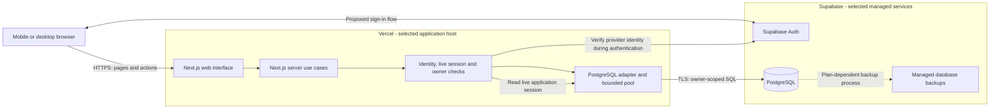
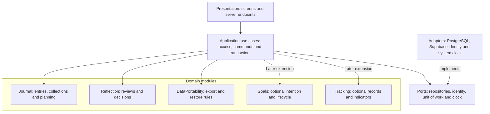
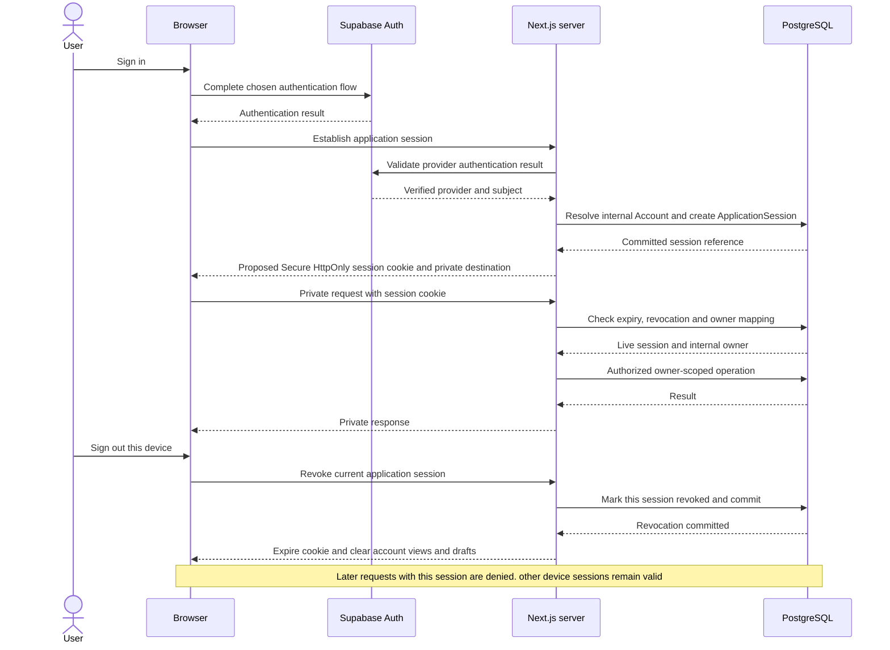
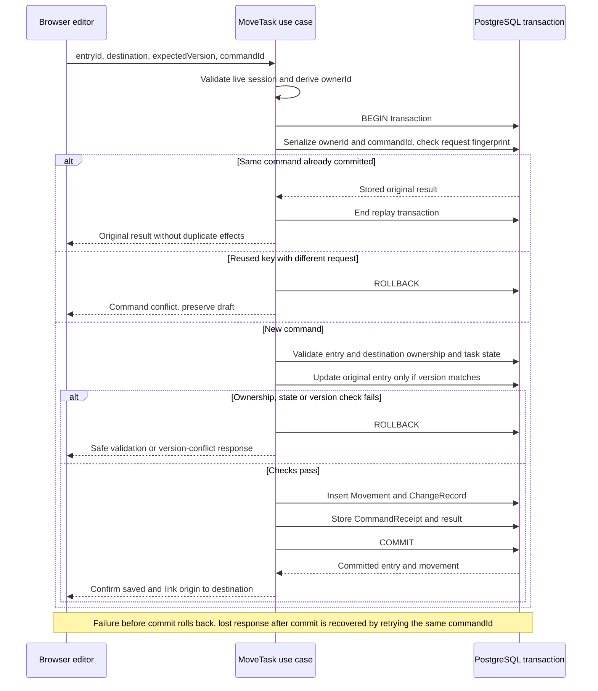
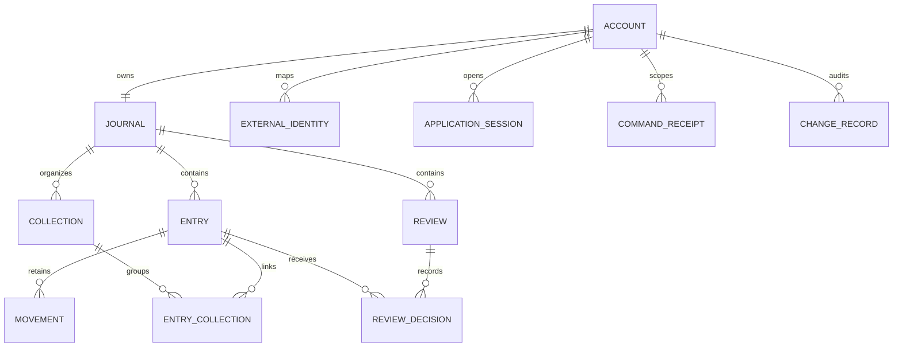

# Architecture diagrams — v0.10

Date: 2026-10-26. These Mermaid diagrams explain the selected MVP architecture and proposed implementation contracts. They describe planned behavior, not deployed infrastructure. Source of truth: [architecture](03-architecture.md), [selected stack](decisions/ADR-003-cloud-stack.md), [domain](02-domain.md) and [requirements](01-requirements.md).

## 1. Cloud components and trust boundaries

Next.js provides both the interface and authenticated server use cases in one application. Supabase supplies identity and PostgreSQL. The diagram shows logical runtime communication, not a finalized region/network configuration. Sign-in transport and callback details remain to specify.

Browser code never receives SQL credentials. ApplicationSession and Account mapping live in application persistence; a valid provider token does not replace live session checks. Provider backup availability is not proof of tested recovery. Private responses bypass shared/public caches. Logs contain redacted operational data rather than journal content.

Traceability: ADR-003; RF-11/18; AC-44/45/71/73/74; RNF-04/06/07.

## 2. Modules and dependency direction

Solid arrows mean source-code dependencies; they do not describe network calls. Infrastructure implements interfaces owned by application/domain boundaries. Journal and Reflection remain usable without Goals or Tracking. All modules below run within the same application; boxes do not imply separate services.

Use cases coordinate cross-module actions. Domain behavior does not import a database driver, Next.js or Supabase SDK. Tracking calculations derive from current source records/tasks instead of an independently authoritative stored percentage. Concrete repository/ORM choices remain open.

Traceability: ADR-004/005; RF-02/05/07/16; AC-51/66/68.

## 3. Proposed sign-in and per-device session lifecycle

This is the existing proposed revocable application-session contract made visible. It does not select email/password, OAuth, invitation flow, cookie lifetime or token storage details. Authentication failures end before creating an application session. Every private operation authorizes its resources after validating the session.

The browser clears its own memory after the response; the server cannot directly erase arbitrary browser memory. An unreachable session store must not grant access. Already in-flight operations and exact session/write coordination need definition in the session contract; the sequence promises denial for subsequent requests after committed revocation. Restoring backups must invalidate restored sessions to avoid resurrecting revoked access.

Traceability: RF-11/18; AC-49/50/73/74/75.

## 4. Proposed atomic task migration and retry

The same principle applies to other multi-entity mutations: business changes, history and command result commit together. A move updates the original Entry rather than creating another task. Identical retried commands return their prior result; version conflict is different from successful replay.

Serialization/locking mechanism and SQL are not chosen here. Cross-owner references are rejected inside the command; expectedVersion prevents lost updates. For pooled connections, trusted owner context is transaction-local if used. A migration does not complete a task or create quantitative progress.

Traceability: RF-05/18; AC-15/16/18/45/46/72; RNF-01.

## 5. Core data relationships

Conceptual ER diagram, not executable schema. It intentionally excludes optional goals, subtasks and structured tracking to emphasize the first demo. Child ownership and owner-consistent references are enforced even where ownerId is not repeated visually. EntryCollection contains collection-local order; Entry retains its daily order.

An Entry exists without a Collection or Goal. Multiple EntryCollection links do not duplicate it. Reviews may have no decisions when they contain only reflection. ReviewDecision may reference an existing movement; detailed keys and uniqueness rules will be specified in the physical schema. A stable Account ID is independent of the identity provider subject.

Traceability: RF-02/05/13/16; AC-13/15/51/57/66; domain identity and command records.

## Reading order and limitations

Read components first, dependencies second, session third, migration fourth and data relationships last. All five diagrams are documentation sources that can be rendered by a Mermaid-capable Markdown viewer. No deployment, cloud tests or recovery drills are implied. Detailed identity UX, database migrations, connection sizes, regions and runtime configuration remain open.

Architecture specialist reviewed the source contracts and supplied consistency checks incorporated here: browser outside trust boundaries, no direct browser SQL, dependency direction distinct from runtime calls, explicit session revocation and atomic command replay. Documentation review only; Mermaid visual rendering has not been executed in this environment.

Syntax validation update (2026-10-26): reproduced the original sign-in parse error with Mermaid 11, replaced unescaped semicolons in both sequence diagrams, and successfully parsed all five corrected diagrams. Parser validation does not imply visual layout verification or application execution.

For user journeys, screen navigation, task lifecycle, monthly review, save recovery and deployment environments, continue with the [six step-by-step walkthrough diagrams](12-project-walkthrough-diagrams.md).
