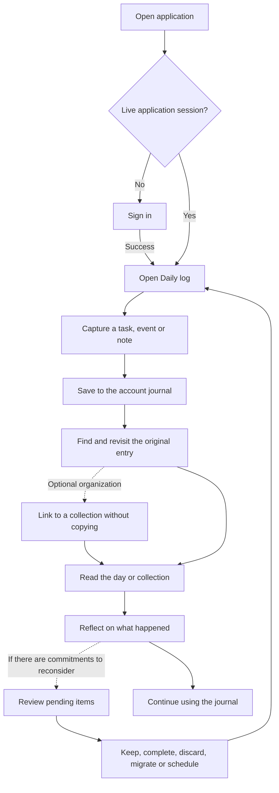
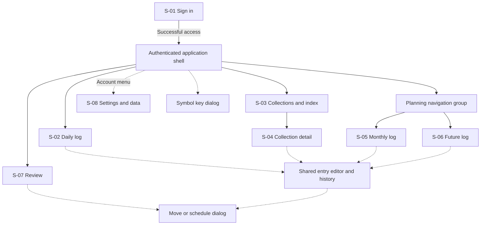
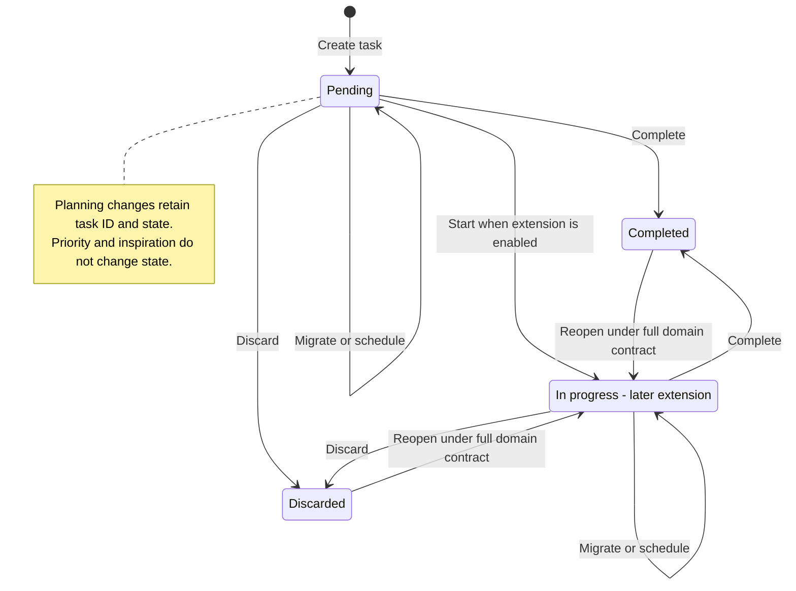
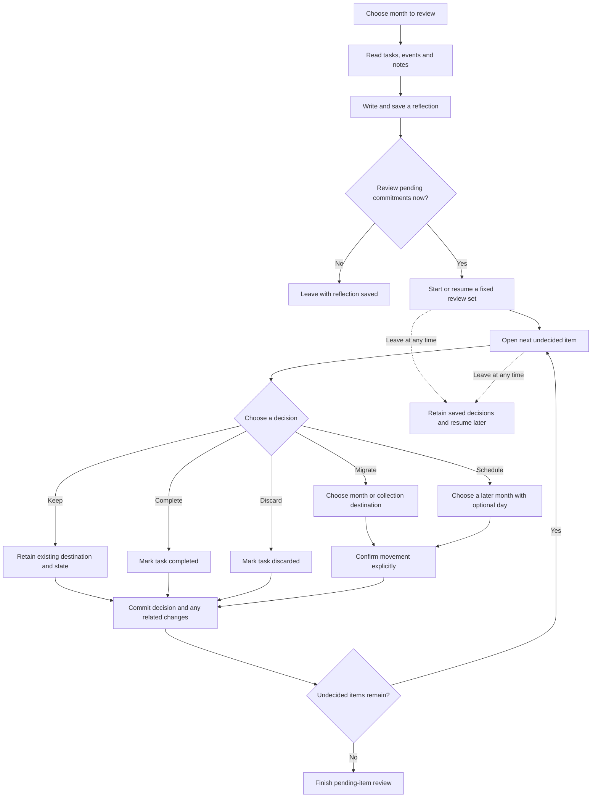
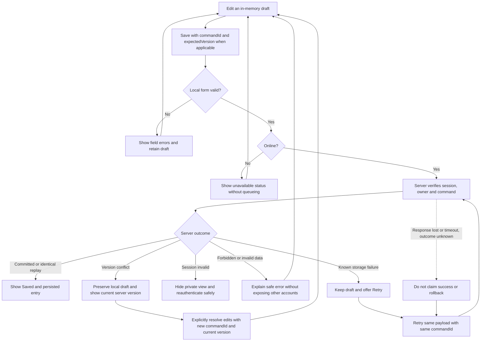
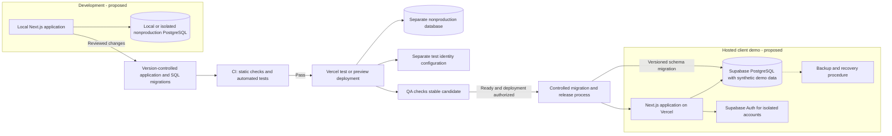

# Project walkthrough diagrams — v0.11

Date: 2026-10-26. Read these six diagrams in order, from user experience to cloud delivery. They explain specifications, not implemented software. English labels follow RF-17. Solid arrows show the transition/dependency named in each section; dashed arrows identify optional paths or proposals.

Sources: [screen specification](10-mvp-screens.md), [domain](02-domain.md), [architecture](03-architecture.md), [requirements](01-requirements.md). The [architecture diagrams](11-architecture-diagrams.md) cover components, modules, sessions, transactional migration and conceptual data relationships.

## Step 1 — Follow a user's journey

Purpose: understand the central value before thinking about infrastructure.

1. Authenticate only when needed, then land on the day rather than a setup wizard.
2. Capture without creating a goal, schema or collection.
3. Add thematic organization only when useful; all views reference the same entry.
4. Reflect without needing numbers. Reviewing pending items is optional and separate.

The save box represents success; failures/retries are expanded in Step 5. Sign-in failure stays on the access flow, with no private data exposure.

Traceability: AC-05/43/44/51/57/61/66/68.

## Step 2 — Understand the screen map

Purpose: distinguish navigation destinations from nested views and shared dialogs.

1. Four main destinations: Daily, Collections, Planning and Review.
2. Month/Future are two Planning views, not extra main navigation tabs.
3. Collection detail opens from the index. Settings is a utility destination.
4. Editors, history, key and move dialogs reuse contextual UI rather than becoming mandatory new pages.

The shell is layout, not a ninth screen. It exposes all four destinations from any authenticated page. Entry links also open original entries across views; this map omits those cross-links for readability.

Traceability: S-01 through S-08; RF-10/13/14/15.

## Step 3 — Read a task's lifecycle

Purpose: separate operational state from planning movements. This diagram shows the full specified domain, including the later in-progress extension.

1. A task begins pending and can be completed or discarded.
2. The optional extension adds explicit start/in-progress behavior.
3. Reopening follows the current full-domain contract and does not create another task.
4. Migrating or scheduling changes destination/history, never completion state. Closed tasks must be reopened before migration. Notes/events have no task lifecycle.

**Open specification issue:** the domain currently reopens to In progress, but the initial screen scope defers that state. Before implementation, agree either to include the minimal in-progress state in the first task flow or to explicitly revise the core-only reopening target. This diagram exposes the inconsistency rather than silently introducing a new transition. It does not remove reopening from AC-06.

Traceability: RF-02/05/08; AC-06/15/18/27–31/65.

## Step 4 — Walk through monthly reflection and migration

Purpose: show the decision process that preserves intentionality.

1. Saving a reflection never requires deciding every pending task.
2. Starting pending review establishes a fixed set, including relevant future commitments becoming current. Later-created tasks do not enlarge it automatically.
3. Keeping is valid. Moves require an explicit destination and confirmation.
4. Completion, discard, planning movement and review decision remain distinguishable in history.
5. Save failures preserve the undecided state and draft rather than pretending a decision was committed. Already-resolved items from another device are reconciled on refresh. A zero-item set can finish without entering the item loop.

Moving future commitments into the current month is explicit, not a background effect of the month changing. The diagram expands task decisions; event commitments becoming current are shown for explicit transfer under AC-62 without task completion/discard states.

Traceability: RF-05/06/14/16; AC-15–18/62/66–68.

## Step 5 — Follow saving, retries and conflicts

Purpose: explain what the user sees and why a repeated request must not create duplicate data. This is an interaction flow; the transaction details remain in architecture diagram 4.

1. “Saving…” starts while persistence is pending; “Saved” appears only after a successful server response.
2. Missing responses do not prove rollback. Retry the original payload with its original key to discover the committed result safely.
3. Editing the payload creates a new command; do not reuse the old commandId for different content. A conflict requires explicit resolution, never silent overwrite.
4. Same-account reauthentication may recover the in-memory draft; changing identity clears/conceals it. No journal content goes into sign-in URLs.
5. No durable offline queue is promised; reloading can lose unsaved edits. A second device obtains committed changes by opening/refreshing, not a realtime push requirement.

Traceability: RNF-01; AC-10/18/46–50/72–74.

## Step 6 — Understand environments and deployment

Purpose: separate where developers work, where checks run, and where a prospective client sees the demo. These are proposed logical environments, not provisioned resources or a promise of free staging.

1. Local development, preview/test and hosted demo have separate credentials and data. Previews never access the hosted demo database.
2. CI gates a candidate, then QA checks relevant acceptance criteria. A passing build alone is not a release decision.
3. Controlled migrations and application releases must be compatible with overlapping versions. This box does not promise migration/app atomicity or automatic schema rollback.
4. The demo uses synthetic content and isolated accounts. Visitor provisioning and sign-in method remain to specify.
5. Test identity/database setup, regions, exact resources and cost are still open. Production readiness also requires the recovery drill, identity reconciliation and restored-session invalidation. Browser sign-in details are omitted here; see the architecture session diagram.

No deployment occurred while creating this documentation. A diagram arrow does not grant purchase/deployment permission.

Traceability: ADR-003; RNF-04/06/07; AC-40/43–50/69/71/74/75.

## Next design work

Resolve the core-only reopening contract, then use this journey/screen map to create low-fidelity Daily log and Collection wireframes. These diagrams explain existing requirements and open proposals; they do not introduce a new dashboard, goal wizard or tracking engine into the first demo.

## Validation evidence

QA performed read-only checks of source contracts for the six diagram topics. Focus incorporated the separation between optional review and capture, planning moves and task states, explicit conflict resolution and retries, and environment/identity isolation. Mermaid 11 successfully parsed all six new diagrams and the five existing architecture diagrams (11 total). This verifies syntax, not visual layout or runtime behavior. No application tests or cloud operations ran.
